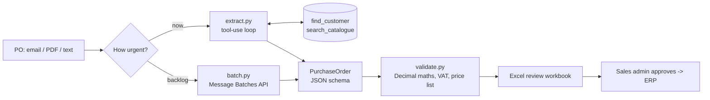

# po-intake-ai

**Customer purchase orders in, checked sales-order data out.**

A manufacturer's sales team receives purchase orders as emails, PDFs and scans, in
every layout. Someone retypes each one into the ERP, matches the customer's wording
to the right product codes and checks the totals. This tool does the reading and
matching with the Claude API, checks every number with ordinary Python, and hands
the team an Excel workbook to approve.



## What it shows

| Area | Where |
|---|---|
| Claude API **tool use**: a manual agentic loop with strict JSON-schema tools | [`extract.py`](src/po_intake/extract.py) |
| **Structured outputs**: one Pydantic model is the response schema and the validator | [`models.py`](src/po_intake/models.py) |
| **Prompt caching**: static prompts; cached prefix across tool rounds and across a batch | [`extract.py`](src/po_intake/extract.py), [`batch.py`](src/po_intake/batch.py) |
| **Batch API**: backlog processing at half price, results matched by `custom_id` | [`batch.py`](src/po_intake/batch.py) |
| Knowing when *not* to use AI: totals, VAT and price checks are deterministic | [`validate.py`](src/po_intake/validate.py), [`docs/DECISIONS.md`](docs/DECISIONS.md) |
| Excel workbooks that check themselves: live formulas plus a Python cross-check column | [`excel.py`](src/po_intake/excel.py) |
| **Claude Code** setup: `CLAUDE.md`, a project skill, hooks that block secrets and lint every edit | [`.claude/`](.claude), [`CLAUDE.md`](CLAUDE.md) |
| Tests that never call the paid API, run in CI on every push | [`tests/`](tests), [`.github/workflows/ci.yml`](.github/workflows/ci.yml) |

## Run it

```bash
python -m venv .venv
source .venv/bin/activate          # Windows: .venv\Scripts\activate
pip install -e ".[dev]"
python -m pytest -q                # no API key needed
```

With an Anthropic API key in `ANTHROPIC_API_KEY`:

```bash
po-intake extract samples/ --xlsx out/review.xlsx      # now, one request loop per PO
po-intake batch submit samples/                        # backlog, 50% cheaper
po-intake batch status msgbatch_...
po-intake batch collect msgbatch_... --xlsx out/review.xlsx
```

The three sample POs are fictional and cover a clean order, an informal email
order and an order with unmatched items and a handwritten change.

What the checks report for the problem PO (illustrative: the wording of the
`extractor_note` lines comes from the model and varies between runs):

```
po-1003-problems.txt: RCS/PO/0092 -> blocked (4 issues)
  [error] line 2 unmatched_item: 'Hinged takeaway containers 750ml (case)' has no catalogue match.
  [error] line 3 unmatched_item: 'Pizza box kraft 14 inch' has no catalogue match.
  [warning] extractor_note: Line 3 quantity 200 is crossed out and 150 handwritten next to it.
  [warning] extractor_note: Delivery date is 'ASAP', not a date.
```

## Design notes

- **Two paths, one schema.** The interactive path lets Claude call lookup tools,
  which scales to large customer lists. Batch requests can't run a tool loop, so
  the backlog path puts the reference data in a cached system prompt instead.
  Both return the same `PurchaseOrder`, so everything downstream is shared.
- **The model reads, code decides.** Claude never decides if an order is valid.
  It extracts and records doubts in `notes`; `validate.py` blocks or flags.
- **Money is `Decimal`.** Floats turn R5.85 into 5.8500000000000005.
- **Refusals and truncation are handled.** `stop_reason` is checked before any
  content is read, and the request opts into server-side fallback models.

More in [`docs/DECISIONS.md`](docs/DECISIONS.md) and [`CHANGELOG.md`](CHANGELOG.md).

## How it was built

Built with [Claude Code](https://claude.com/claude-code) as the main development
environment. The project's [`CLAUDE.md`](CLAUDE.md) holds the rules the agent must
follow, a project skill handles the most common change, and hooks block secret
files and lint every edit before it lands. I set the architecture and the business
rules, reviewed every change and wrote the decision log.

## Licence

MIT
